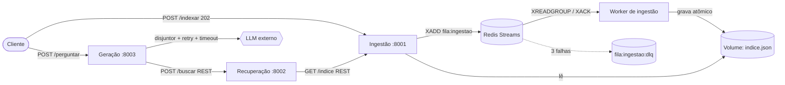
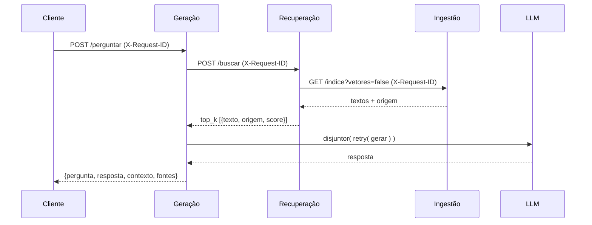

# RAG Distribuído em Microsserviços — C2.A2

**Sistemas Distribuídos e Computação em Nuvem · FAESA · 2026/2**

Sistema de perguntas e respostas sobre documentos próprios (RAG) decomposto em **três
microsserviços + um worker**, comunicando-se por **REST** e por uma **fila Redis Streams**,
com **circuit breaker + retry com backoff** protegendo a dependência externa (LLM).
Roda 100 % offline: sem `LLM_API_KEY` o cliente de LLM entra em modo simulado.

## Arquitetura



### Ingestão (assíncrona, via fila)

```mermaid
sequenceDiagram
    participant C as Cliente
    participant I as Ingestão (API)
    participant R as Redis Streams
    participant W as Worker
    participant V as Volume (indice.json)
    C->>I: POST /indexar [docs]
    I->>R: XADD fila:ingestao (lote)
    I-->>C: 202 {lote}
    W->>R: XREADGROUP (consumer group)
    W->>V: dedup por hash + reajusta TF-IDF + grava (tmp + os.replace)
    W->>R: XACK + status "concluido" (só após persistir)
    C->>I: GET /indexar/{lote}
    I-->>C: {estado: concluido, novos, total}
    Note over W,R: falhou? re-enfileira com tentativas+1; na 3ª vai p/ fila:ingestao:dlq
```

### Pergunta (síncrona)



## Serviços, portas e rotas

| Serviço | Porta | Rotas |
|---|---|---|
| **Ingestão** | 8001 | `POST /indexar[?sincrono=true]` (202 + lote), `GET /indexar/{lote}`, `POST /indexar-arquivos`, `GET /indice[?vetores=false]`, `GET /saude` |
| **Worker de ingestão** | — | consome `fila:ingestao` (sem HTTP; healthcheck por batimento) |
| **Recuperação** | 8002 | `POST /buscar` → `{"resultados":[{texto, origem, score}]}`, `GET /saude` |
| **Geração** | 8003 | `POST /perguntar` → `{pergunta, resposta, contexto, fontes}`, `GET /saude` (estado do disjuntor) |
| Redis | 6379 | fila (Streams) |

Erros claros: Ingestão fora → Recuperação responde **503**; Recuperação fora → Geração
responde **503** (ou **502** se ela devolver erro interno); LLM falhando → **502**; circuito
aberto → **503 + `Retry-After`**. Nunca um 500 com stack trace. Quando o LLM falha
(502/503), o corpo da resposta ainda traz `contexto` e `fontes` (os trechos recuperados) com
`resposta: null`: a recuperação segue útil mesmo com o LLM fora do ar.

## Decisões de projeto (o que explicar na entrega)

1. **Por que fila na ingestão?** Indexar é custoso (reajusta o TF-IDF e regrava todos os
   vetores) e não precisa de resposta imediata. A fila desacopla a API do processamento:
   a API responde 202 na hora, absorve picos e o worker processa no seu ritmo.
   A consulta (`/perguntar`) é síncrona porque o usuário espera a resposta.
2. **Redis Streams** (e não lista): consumer group + `XACK` dá entrega *ao menos uma vez*.
   O `XACK` só ocorre **depois** de o índice ser persistido; se o worker morrer no meio,
   a mensagem fica pendente e é retomada (na reinicialização do consumidor ou via
   `XAUTOCLAIM`). Como a indexação deduplica por hash, reprocessar é inofensivo
   (idempotência). Falhas → re-enfileira com `tentativas+1`; na 3ª vai para a **DLQ**.
3. **Onde mora o índice:** arquivo JSON em volume compartilhado entre API e worker.
   Escrita **atômica** (arquivo temporário + `fsync` + `os.replace`) sob um lock de
   arquivo, então um leitor nunca vê arquivo pela metade; a API detecta mudanças do
   worker pelo `mtime` e recarrega. É simples e suficiente aqui; veja limitações.
4. **Vocabulário TF-IDF:** o vocabulário/IDF depende do corpus inteiro e muda a cada
   ingestão (a dimensão dos vetores muda). A Ingestão reajusta sobre o corpus completo e
   reindexa todos os itens. A **Recuperação não usa esses vetores**: ela pede
   `/indice?vetores=false` (só textos), reajusta um `Vetorizador` **local** e vetoriza
   pergunta e itens com o mesmo vocabulário. O resultado fica em cache, invalidado
   quando `(total, versao)` do índice muda. Assim os dois lados nunca ficam
   inconsistentes, e a Recuperação não depende do formato interno da Ingestão.
   O TF-IDF ignora acentos e palavras funcionais do português ("de", "qual", "que"…),
   para que perguntas fora do domínio ("receita de bolo") não casem com os documentos por
   ruído. Itens com score abaixo de `SCORE_MINIMO` (0,05) não são devolvidos.
5. **Ordem retry × breaker:** `disjuntor.chamar(com_retentativas(gerar))`. O retry fica
   **por dentro**: um solavanco isolado (timeout, 429, 5xx, ConnectionError) é absorvido
   por retentativas com **backoff exponencial + jitter** (0,5 s·2ⁿ, teto 5 s, 3
   tentativas) e **não** conta para o disjuntor; só quando os retries se esgotam é que
   conta **uma** falha. Assim o disjuntor mede "o LLM está realmente fora?" e não ruído, e
   quando está aberto ele evita multiplicar chamadas (e esperas) inúteis. Erros 4xx
   (exceto 429) não são repetidos. O timeout por tentativa é `LLM_TIMEOUT` (20 s).
6. **Parâmetros do breaker:** abre após **3** falhas (já com retries esgotados) e espera
   **20 s** antes de testar (`BREAKER_LIMITE_FALHAS`, `BREAKER_ESPERA`). No estado
   `meio` passa **uma única** chamada de teste (as demais recebem 503); `threading.Lock`
   protege o estado porque o uvicorn atende em várias threads; cada transição é
   logada. `/saude` expõe estado, falhas, limite e segundos até reabrir.
7. **Rastreamento:** `X-Request-ID` é gerado (ou herdado) na entrada, repassado
   Geração → Recuperação → Ingestão e impresso em todos os logs (`[rid=...]`).

## Como rodar

### Com Docker (reprodutível, offline)

```bash
docker compose up --build            # redis, ingestao, worker-ingestao, recuperacao, geracao
SEM_SUBIR=1 scripts/demo.sh          # (outro terminal) indexa documentos/ pela fila e pergunta
# ou só indexar: docker compose --profile seed up seed
```

`scripts/demo.sh` (sem `SEM_SUBIR`, ele próprio roda `docker compose up -d --build --wait`)
indexa `documentos/`, espera o worker e pergunta "o que diz o teorema CAP?", mostrando
resposta, contexto e fontes.

### Localmente (sem Docker)

```bash
python -m venv .venv && source .venv/bin/activate     # Windows: .venv\Scripts\activate
pip install -r requirements-dev.txt                   # requirements.txt tem versões pinadas p/ Python 3.11
bash scripts/dev_local.sh                             # Redis falso (fakeredis) + 3 serviços + worker
SEM_SUBIR=1 bash scripts/demo.sh
```

Com um Redis real instalado, rode manualmente (cada um em um terminal; `cp .env.example .env`
é opcional e já vale aqui):

```bash
uvicorn servicos.ingestao.app:app --port 8001
python -m servicos.ingestao.worker
uvicorn servicos.recuperacao.app:app --port 8002
uvicorn servicos.geracao.app:app --port 8003
```

> **Roteiro do kit (só os 3 `uvicorn`, sem Redis/worker):** `POST /indexar` continua
> funcionando — sem Redis a Ingestão degrada para indexação síncrona (200 + `"aviso"`),
> então o passo 6 do kit e a pergunta do passo 7 funcionam. Com Redis + worker no ar, o
> mesmo endpoint responde 202 e passa pela fila.

### LLM real (opcional)

Defina variáveis de ambiente — **nunca no código**. Copie `.env.example` para `.env`
(ignorado pelo git) e preencha `LLM_API_KEY`, `LLM_API_URL`, `LLM_MODELO`. O `.env` é
lido tanto pelo `docker compose` quanto pelos serviços rodando localmente
(`python-dotenv`; o ambiente do shell tem prioridade). Sem `LLM_API_KEY`, o modo
simulado é usado.

### Testes

```bash
pytest -q                       # unitários: breaker, retry/backoff, busca, ingestão, fila/DLQ, API
python scripts/avaliar.py       # avaliação simples da recuperação (precisão@1), com tudo no ar
```

### Demonstração de falhas

```bash
scripts/teste_falhas.sh | tee docs/evidencias/teste_falhas.txt
```

Cobre: (a) LLM simulado funciona sem internet; (b) `docker compose stop recuperacao` →
`/perguntar` devolve 503 claro; (c) injeção de falha no LLM → após 3 falhas o circuito
abre (503 + `Retry-After`), passa por `meio` após a espera e volta a `fechado`;
(d) lote inválido na fila → 3 tentativas → DLQ.

A injeção de falha é opcional e desligada por padrão: `LLM_SIMULAR_FALHA=1`,
`LLM_SIMULAR_FALHA_TAXA=0.7` ou `LLM_SIMULAR_FALHA_ARQUIVO` (falha enquanto o arquivo
existir; o compose usa `/tmp/llm_falha`, ligado/desligado sem reiniciar o container).

Sem Docker, aponte os comandos do script para `scripts/dev_ctl.sh`:

```bash
LLM_SIMULAR_FALHA_ARQUIVO=dados/llm_falha BREAKER_ESPERA=8 scripts/dev_local.sh &
CMD_PARAR_REC="scripts/dev_ctl.sh parar-rec" CMD_INICIAR_REC="scripts/dev_ctl.sh iniciar-rec" \
CMD_LIGAR_FALHA="scripts/dev_ctl.sh ligar-falha" CMD_DESLIGAR_FALHA="scripts/dev_ctl.sh desligar-falha" \
CMD_XADD_INVALIDO="scripts/dev_ctl.sh xadd-invalido" scripts/teste_falhas.sh
```

## Limitações conhecidas

- O índice é um único arquivo JSON relido por inteiro a cada mudança: serve para
  centenas/milhares de trechos, não para milhões (para isso, um banco vetorial).
- O estado do disjuntor é por processo da Geração (réplicas não o compartilham).
- A Recuperação baixa os textos do índice a cada consulta para detectar mudanças
  (`total`/`versao`); só reconstrói os vetores quando eles mudam.
- A fila é *ao menos uma vez*; a idempotência vem da deduplicação por hash.
- TF-IDF é lexical (não entende sinônimos); trocar por sentence-transformers manteria a
  interface `ajustar/vetorizar`, mas exige download e foge do modo offline.
- Reranking e sentence-transformers não foram implementados.
- Extensões feitas: citação de fontes e avaliação automática simples (`scripts/avaliar.py`).

---

# Enunciado original do kit

## Como você será avaliado

| Critério | Pontos |
|---|---|
| Arquitetura e decomposição em serviços | 1,5 |
| Comunicação funcionando (REST / gRPC / mensageria) | 1,5 |
| Resiliência e tratamento de falhas | 1,0 |
| Execução reproduzível (README, container, deploy) | 1,0 |
| **Sofisticação do modelo de IA** | **não pontua** |
| **Total** | **5,0** |

**Entrega:** no seu repositório do GitHub, **sem apresentação oral**. Grupos livres.

---

## Aulas de referência

- **Aula 8** — Mensageria, eventos e API Gateway
- **Aula 10** — Replicação, consistência e CAP
- **Aula 11** — Consenso (Raft) e resiliência: circuit breaker
- **Aula 6** — IA como serviço (vocabulário: embedding, inferência, LLM)

---

## Dúvidas frequentes

**Preciso saber machine learning?** Não. O modelo já está pronto e você só chama uma função.

**E se eu não tiver internet no laboratório?** Tudo neste kit funciona offline. O modelo é
treinado localmente e o cliente de LLM tem modo simulado.

**Posso trocar a linguagem?** O kit é em Python porque é o ecossistema usado nas aulas.
Se quiser usar outra linguagem, converse com o professor antes.

**Posso usar IA para me ajudar a programar?** Sim. Este é um trabalho prático feito fora de
sala, e usar ferramentas de IA é realista. O que se avalia é o **sistema funcionando** e as
**decisões de arquitetura** — que você precisa saber explicar.
